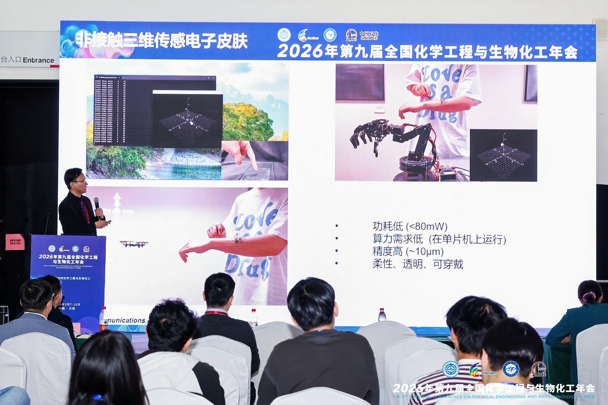








# Jingkun Zhou

Dr. Jingkun Zhou got the Overseas Excellent Young Scientists Fund. He will join **Tsinghua Shenzhen International Graduate School (Tsinghua SIGS)** as an Assistant Professor and Doctoral Supervisor at the Institute of Biopharmaceutical and Health Engineering in December 2026. Dr. Zhou is currently a PostDoc fellow at Department of Biomedical Engineering, City University of Hong Kong and an Associate Research Scientist at the Hong Kong Centre for Cerebro-Cardiovascular Health Engineering Limited (COCHE). He holds a Ph.D. in Biomedical Engineering from City University of Hong Kong, specializing in human-computer interface and flexible electronics, following a Master’s degree from Tsinghua University. He has published over 50 research papers (15 as first or co-first author) in top-tier international journals, including ***Nature, Nature Electronics, Nature Machine Intelligence, Nature Communications, and Science Advances***. His research focuses on **advancing flexible electronics and smart AR/VR haptic feedback systems, bridging materials science, bioelectronics, and computer science**. 

# 🔥Job Openings
The lab's research focuses on human-machine integration and smart health, centered on flexible-electronics-driven **intelligent sensing, physiological signal detection, and human-computer interfaces**.
We are recruiting PhD students, Postdocs, and Research Assistants from a wide range of backgrounds including electronics, computer science, microwave engineering, micro/nano fabrication, materials science, and biomedical engineering. Candidates with research experience in flexible electronics, bioelectronics, or robotics are especially welcome.
To apply, send the following materials to <a href="mailto:jingkzhou3-c@my.cityu.edu.hk">jingkzhou3-c@my.cityu.edu.hk</a> with the subject line "[Position] + [Semester] + [Your Name]":
<ol>
  <li>CV (including education, working experence, publications, and project involvement);</li>
  <li>1–2 representative publications;</li>
  <li>A cover letter explaining your research interests.</li>
</ol>

  <h3>Research Keywords</h3>
  

# 🔥 News

- *2026.05*: &nbsp;🎉🎉  Jingkun Zhou gave an invited talk at the 9th National Conference on Chemical Engineering and Biotechnology in 2026. 

9thNCCEB

- *2026.03*: &nbsp;🎉🎉  Jingkun Zhou and Yuqiong Wang were interviewed by China News regarding the ***Cell*** paper titled "An organ-conformal, kirigami-structured bioelectronic patch for precise intracellular delivery." [Video](https://m.chinanews.com/wap/detail/chs/sp/10594922.shtml?params=eyJwbGF5TW9kZSI6InZlcnRpY2FsIn0=)

